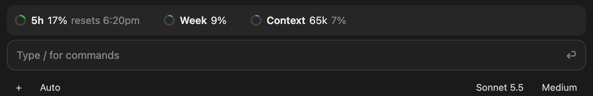
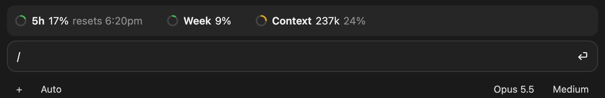

# usage-tracker

A Claude Code mod that shows your plan usage and context window as a row of small rings above the prompt:

```
◔ 5h 4% resets 3:40pm      ◔ Week 18%      ◔ Context 68k 34%
```



*The images are mockups: the rings are drawn by the mod's own `ringSvg` code, set in a page styled like the desktop app's prompt.*

- **5h** – the 5-hour rate-limit window, with the time it resets.
- **Week** – the weekly rate-limit window.
- **Context** – tokens in this session's context window, then the percentage of the window used. The ring is blue and turns yellow once the context passes 200k tokens.

Each ring fills clockwise from the top. The 5h and Week rings are green below 50%, yellow from 50% and red from 80%. Any usage above 0% shows at least a sliver of the ring.

How the ring is drawn depends on where Claude Code runs:

- **Claude desktop and mobile apps:** an SVG ring.
- **Terminals with the kitty graphics protocol** (kitty, Ghostty): an inline image of the same ring.
- **Other terminals:** a pie glyph in quarter steps (○ ◔ ◑ ◕ ●).

The rate-limit figures come from Claude Code itself and refresh after each response, so they appear only on a Claude subscription and only once the session has had its first reply.

## Install

Clone the repo:

```bash
git clone https://github.com/starlabs007/claude-mod-usage-tracker.git ~/claude-mods/usage-tracker
```

Then load it in one of two ways.

**For one terminal session**, pass the folder with `--plugin-dir`:

```bash
claude --plugin-dir ~/claude-mods/usage-tracker
```

**For every session, including the desktop app**, add the folder to `CLAUDE_CODE_PLUGIN_DIRS` in the `env` block of `~/.claude/settings.json`:

```json
{
  "env": {
    "CLAUDE_CODE_PLUGIN_DIRS": "~/claude-mods/usage-tracker"
  }
}
```

Check it with `claude plugin validate ~/claude-mods/usage-tracker`.

## Files

| File | Purpose |
| --- | --- |
| `.claude-plugin/plugin.json` | Plugin manifest |
| `hooks/hooks.json` | Points Claude Code at the hooks module |
| `hooks/register.tsx` | Reads the usage figures and draws the row |
| `types/index.d.ts` | Types for the values the mod keeps in session state |

Function hooks are an early-access Claude Code feature, and their API may change between releases.

## License

MIT
